# GDG上學期社課｜Idea to Project：一個人的想法怎麼突然變成一坨 Code 了？
## 先給你偷看的目錄

- [前言：什麼是專案？](#前言什麼是專案)
- [先來做個小實驗：同一句話，三個傳送門](#先來做個小實驗同一句話三個傳送門)
- [出發之前：想法哪裡來啊](#出發之前想法哪裡來啊)
- [1. 從痛點拆出真正的問題](#1-從痛點拆出真正的問題)
- [2. 把想法畫成一條路：4 步使用流程](#2-把想法畫成一條路4-步使用流程)
- [3. 新手的三個問題：有沒有人要？做不做得出來？做不做得完？](#3-新手的三個問題有沒有人要做不做得出來做不做得完)
- [4. MVP：把那條線畫出來](#4-mvp把那條線畫出來)
- [5. 把 MVP 切成一步一步](#5-把-mvp-切成一步一步)
- [6. 專案起步卡：一份給人也給 AI 看的文件](#6-專案起步卡一份給人也給-ai-看的文件)
- [收尾：讓專案真的開始](#收尾讓專案真的開始)

#### 小前提：雖然這篇文章只會簡單帶過大部分專業的東西，但是建議初學者反覆觀看，尤其開始一個專案或是結束一個專案的時候，或許能找到自己需要的鉤子。

> 專案可沒有交作業的按鈕，你要讓你自己、使用者甚至是客戶能使用，還需要做什麼？

很多人可能有這個疑問，今天我們就來講一個軟體專案怎麼冒出來的。

我在做自己的專案的時候，很常會是突發奇想的，可能在上課做白日夢的時候、可能在期中考的時候。一段時間下來，我會累積很多亂七八糟的點子，但是這時候我相信很多人就卡住了：我這個點子到底有沒有用、能不能做、要怎麼做。我也是這樣的，所以在我學到一些東西後，就找了一些方法來「分析」「規劃」我的想法，甚至有時候我完全不知道要幹嘛，也需要找靈感，我也會分享我怎麼找專案靈感。

先從一個小知識開始。

一般人以為的工程師 Belike：
寫程式 > 寫程式 > 寫程式

事實上的工程師需要會：
<details>
<summary>點一下箭頭</summary>

這些
```
Requirements Engineering → Stakeholder Analysis → Problem Definition → Requirements Elicitation → Requirements Specification → Requirements Validation → Scope Definition → Feasibility Analysis → Constraint Identification → Risk Assessment → Project Planning → Work Breakdown Structure → Effort Estimation → Resource Planning → Dependency Management → Scheduling → Architecture Design → System Decomposition → Component Design → Interface Design → Data Modeling → Technology Selection → Design Trade-off Analysis → Implementation Planning → Version Control → Branch Management → 寫程式 → Code Review → Static Analysis → Unit Testing → Integration Testing → System Testing → Acceptance Testing → Test Planning → Test Automation → Continuous Integration → Continuous Delivery → Deployment → Configuration Management → Environment Management → Observability → Logging → Monitoring → Incident Detection → Failure Analysis → Debugging → Root Cause Analysis → Performance Analysis → Security Considerations → Reliability Engineering → Documentation → Knowledge Management → Technical Debt Management → Refactoring → Maintenance → Change Management → Release Management → User Feedback → Requirement Reassessment → Iterative Improvement → 然後不知道為什麼繼續寫程式
```
</details>

所以軟體專案有很難嗎？想知道的話，我們先從最根本的問題開始。

---

## 前言:什麼是專案?

> 「專案（Project）是在獨特背景下，為了創造價值而發起的暫時性措施。」——PMBOK® Guide

這句是專案管理界的聖經《PMBOK 指南》給的定義，我第一次看到也覺得超深奧，但是拆開來看，其實就是三件事：

```text
我要完成什麼？       → 範疇（Scope）
什麼時候要完成？     → 時間（Time）
我有多少資源可以用？ → 資源（Resources）
```

所以專案管理說穿了，就是在這三個限制裡面，想辦法把目標完成。

如果你想認識專案管理，先知道下面這幾個字的差別就好，知道了就可以開始做專案了：

| 名詞 | 意思 | 會結束嗎？ |
| --- | --- | --- |
| **Project 專案** | 為了完成一個目標而進行的暫時性工作 | 會，目標達成就結束 |
| **Program 計畫** | 把多個相關的專案組合起來一起管理 | 等所有專案都完成 |
| **Product 產品** | 專案最後產生、並持續提供價值的東西 | 不會，只要還有人在用 |

### 軟體專案長什麼樣子？

上次課程我們教了 AI coding 的工作流：功能分析、系統設計、程式編寫、測試與維護。
其實傳統的軟體專案大致上也是這樣走，排成一條線，有個稱呼叫做**瀑布式模型（Waterfall Model）**：

```text
需求分析 → 系統設計 → 寫程式 → 測試 → 上線與維護
   一關一關往下流，像瀑布一樣不回頭
```

個人開發、小專案，用這條線其實就很夠了。

不過現在很多團隊為了更快推出新版本、搶在別人前面，又發明了一堆開發方式，AI 進來之後更是每隔幾個月就冒出一個新名詞。這些看看就好，不用背，知道它們各自在解決什麼問題就夠了。

:::spoiler 想當科技 PM、或是想追新東西的同學，點開來看看，然後再去做更多搜尋：

先看三種節奏長什麼樣子：


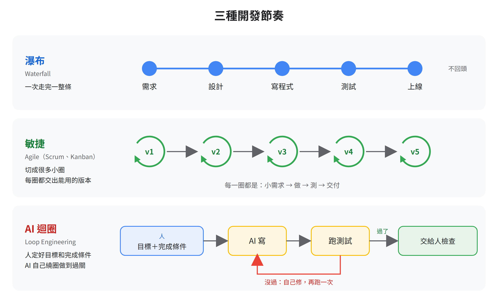

**基本款：到現在還是很多團隊在用**

| 開發方式 | 一句話 | 它在解決什麼？ |
| --- | --- | --- |
| **瀑布** | 一次走完一整條線 | 需求很清楚、不太會變的時候最省事 |
| **敏捷：Scrum** | 每 1–4 週一個衝刺（Sprint），每天站會對進度，衝刺結束交出成果 | 需求一直變，與其一次做對，不如快速修正（參考 [2020 Scrum Guide](https://scrumguides.org/scrum-guide.html)） |
| **敏捷：看板 Kanban** | 把工作攤在看板上，限制「同時在做」的數量 | 事情太多、優先順序一直變 |
| **DevOps／CI/CD** | 開發和維運合在一起，測試、打包、上線全部自動化 | 想要天天、甚至一天好幾次更新 |

**產品和新創圈很常聊的**

| 開發方式 | 一句話 | 它在解決什麼？ |
| --- | --- | --- |
| **精實創業 Lean Startup** | 先做最小可行產品（MVP），做 → 量 → 學，再決定下一步 | 花好幾個月做出一個沒人要的東西 |
| **Shape Up** | 軟體公司 Basecamp 的做法：先決定這件事「值得花幾週」，時間定死，做不完就砍範疇 | 估時永遠不準、待辦清單永遠做不完 |

**AI 時代：這兩年科技社群吵最兇的**

| 開發方式 | 一句話 | 它在解決什麼？ |
| --- | --- | --- |
| **Vibe Coding** | 2025 年初 Andrej Karpathy 提出的說法：跟著感覺叫 AI 寫，幾乎不看程式碼 | 很快就能做出能動的東西，但專案一大就容易失控（第五課聊過） |
| **規格驅動開發 Spec-Driven Development** | 先寫規格 → 計畫 → 任務，再交給 AI 實作；GitHub 的 Spec Kit、AWS 的 Kiro 都在推 | AI 寫得很快，但常常寫出「看起來對、其實不是你要的」 |
| **上下文工程 Context Engineering** | 2025 年中由 Shopify 執行長 Tobi Lütke 提出、Karpathy 推廣：重點不是咒語般的 prompt，而是給 AI 剛剛好的資訊 | AI 資訊給太少會亂猜，給太多會迷路又燒錢 |
| **迴圈工程 Loop Engineering／AI 軟體工廠** | 2026 年開始流行：不再每一步自己下 prompt，而是設計一個讓 AI agent 自己寫、自己測、自己修的迴圈；很多 agent 分工串起來，就被叫做「軟體工廠」 | 人一直盯著 AI 一步一步改太慢；但也有人提醒，寫得快不等於交付得快，而且很燒錢 |


:::

### 那我們除了寫程式，還可以多做什麼？

在我認識的一些人裡面，剛開始想做專案的人大概可以分成兩種：

```text
第一種：我會（用 AI）寫 code，我想做東西！
       → 叫 AI 開始寫、開始改 → 做了一段時間 → 「欸，我下一步要做什麼？」

第二種：我想做，但是我完全不知道從哪裡開始ㄚㄚㄚ（T_T）
```

不管你是哪一種，我都會建議先試著寫一份給自己的**專案規劃書**，用來搞清楚「自己」究竟想做什麼。
同時，這份規劃也會是你之後拿去跟夥伴、教授、客戶、評審交流的第一份重要資料。

一份完整的軟體專案規劃，大概會長這樣：

```text
一份軟體專案規劃
│
├── 前期藍圖（任何專案都需要）
│   ├── 痛點分析 ★
│   ├── 問題定義 ★
│   ├── 客群分析
│   ├── 使用情境 ★
│   └── 目標與範疇 ★
│
└── 軟體設計規劃
    ├── 功能與非功能需求 ★
    ├── 架構設計
    ├── 技術選用與理由
    ├── 開發管理規劃 ★
    ├── 品質管理規劃 ★
    ├── 風險與限制 ★
    ├── 預期成果
    └── 驗證與 MVP 測試 ★
```

看起來很多吧，幾個比較抽象的我舉個例子：

- **功能 vs 非功能需求**：傳送門要「聽得懂台語、能傳送人跟鹹酥雞」，這是功能；「傳送要在十秒內完成，不然後面的阿嬤會按喇叭」，這是非功能，它沒辦法變成一顆按鈕，但一樣是需求。
- **技術選用**：像是我開發的時候，第一個考量的是組員熟不熟，第二個是用的人多不多，因為我們很常需要查資料或找錯誤，網路上討論的人越多越好查。
- **品質管理**：就像數學要驗算一樣，先把驗算式寫好，做完就可以馬上檢查。如果你的作品有穩定的使用者，這件事就更重要了，總不能發布更新之後，阿不小心把線上遊戲的段位計算寫反了，結果都沒人發現，然後被玩家抗議到爆。
- **風險與限制**：技術卡關、死線逼近、組員退選、外部服務突然要收錢……最重要的是，要**預留一點時間給那些你現在還不知道、但一定會發生的問題**。

自己開發的時候不一定每一項都要有，挑你覺得當下最重要的記下來就好。今天我們只會走有 ★ 的那幾條，而且每一條都只走最短的路：

```text
痛點分析、問題定義  → 寫出一句問題句
使用情境            → 畫出 4 步使用流程
風險與限制          → 過三關：有沒有人要？做不做得出來？做不做得完？
開發管理規劃        → 算出時間預算
目標與範疇、驗證     → 畫出 MVP 那條線
功能需求、品質管理   → 切出第一個切片，寫好怎麼驗收
```

---

## 先來做個小實驗:同一句話,三個傳送門

在出發之前，我們先來玩一下。打開你最常用的 AI，開三個新對話，每一個都貼同一句話：

```text
幫我設計一個傳送門 App，解決台灣人不能飛的問題。
```

你很可能會拿到三個完全不一樣的東西：

| | 第一次 | 第二次 | 第三次 |
| --- | --- | --- | --- |
| 長相 | 一扇會發光的門，按下去播一段傳送動畫 | 輸入目的地，幫你排捷運、公車、YouBike 路線 | 一個「傳送鹹酥雞」的外送平台，還要你先註冊會員 |
| 你的反應 | 很酷，然後呢？ | 欸好像有點用，但我沒說要查路線 | 我只是不想遲到而已…… |

三個都能動，三個都不是你要的。

為什麼？因為你腦中其實有一堆**沒講出口的決定**：

```text
- 是真的要把人傳過去，還是告訴我怎麼最快到就好？
- 只有我自己用，還是全台灣的人都要用？
- 要聽得懂台語嗎？
- 用手機打開，還是要蓋在捷運站旁邊？
```

你沒講，AI 就只能猜，而且每一次猜的都不一樣。

> **Generate ≠ What I want.** 上一課我們說 AI 寫出來的不一定對；這一課再補一句：AI 寫出來的，也不一定是你要的。

所以今天做的每一件事，問題句、使用流程、MVP、切片，其實都是在把你腦中那些「沒講出口的決定」寫下來。寫給自己看，也寫給 AI 看。每一段都會寫下一小塊，最後拼起來，就是一張屬於你的**專案起步卡**。


---

## 出發之前:想法哪裡來啊

如果是問我，我的想法大多不是專注在一個討論，或是坐下來仔細想想的時候。事實上大部分都源自於一些很突然的時候，上廁所的時候、吃飯的時候、期中考的時候、睡覺前的時候……。

隨手記下一些零碎的想法在紙上或手機上是個不錯的方式。

先推薦兩篇文章，有點古老，但這是我找到最貼近我想講的：
1. [IDEO 設計思維](https://designthinking.ideo.com/process)
2. [Paul Graham：How to Get Startup Ideas](https://www.paulgraham.com/startupideas.html)

> **不要「想出」Idea，要「注意到」Idea。**

好的想法常常不是坐在桌前說「我要想一個超棒的專案」硬想出來的，而是來自下面這三種地方：

```text
想法從哪裡來？
│
├── 1. Problem-driven：「我遇到了什麼問題？」
│      每次下載的檔案都亂七八糟 → 做一個檔案整理 AI Agent
│
├── 2. Interest-driven：「我對什麼東西感興趣？」
│      我很喜歡音樂 → 我一直想知道手勢能不能指揮音樂 → 手勢辨識 × 音樂控制
│      （這甚至不需要痛點，就是「這東西感覺很酷，我想玩玩看」）
│
└── 3. Domain-driven：「我進入一個不熟的領域，看到了什麼奇怪的東西？」
       資工學生跑去社團、醫院、餐廳、行銷、運動、音樂、遊戲……
       然後突然：「蛤？你們現在還在這樣做？為什麼？」
```


在我過去的感受裡，最大的就是**跨領域碰撞**很容易產生 Idea：懂程式的人進入另一個領域，很容易看到那個領域還沒被軟體解決的問題；另一方面，法商人也可以在科技業發現更多還沒被解決的問題，或是帶著自己學到的東西再回到原本的領域。

我會說：
> 到處跨領域是在找新的靈感，雖然我沒有什麼偉大的成就給同學們當範例，但我覺得這是可以參考的一條有趣的路。

所以你可以把「找 Idea」變成一個**觀察任務**：這週記錄 5 件讓你「欸？」的事情，完全不要求它們是好 Idea。

「欸？」其實有很多種，每一種都通往不一樣的地方：

```text
生活中讓你「欸？」的那一刻
│
├── 好煩 ................. → Problem（問題）
├── 好怪 ................. → Opportunity（機會）
├── 好酷 ................. → Interest（興趣）
├── 為什麼沒有？ ......... → Gap（缺口）
├── 如果可以這樣就好了 ... → Idea（點子）
└── 我想試試看 ........... → Project（專案）
```


> **不要逼自己想出一個 Idea。先去生活、去玩、去學、去觀察，然後注意那些讓你「欸？」的東西。**

### ✏️ 練習：我的「欸？」清單

寫下 3 件最近讓你「欸？」的事，圈一個今天要用的。像是：

```text
1. 每次社課都有人不會用 Git
2. Discord 裡的資訊很容易被洗掉
3. 社團課的同學好像很常沒來（T_T）
```

> 真的想不到也沒關係，可以先用你所屬社團小專案的主題，把今天的練習走一遍，方法是一樣的。

:::spoiler 課後看：點子太多，挑不出來？

把你的「欸？」清單拿來打個分數：

| 點子 | 多常發生？ | 多痛？ | 現在怎麼解決？ | 我自己會用嗎？ |
| --- | --- | --- | --- | --- |
| 社課有人不會用 Git | 每次社課 | 中 | 講師一個一個教 | 會 |
| Discord 資訊被洗掉 | 每天 | 中 | 往上滑、再問一次 | 會 |
| 社課同學常常沒來 | 每週 | 高（對講師來說） | 群組提醒 | 會 |

沒有標準答案，但如果某一欄你寫不出來，那一欄就是你該去調查的地方。

還有一個反直覺的小提醒：Paul Graham 寫過一篇文章叫〈[Schlep Blindness](https://paulgraham.com/schlep.html)〉，Schlep 是「又累又煩的苦差事」。他觀察到，人的大腦會自動忽略那些「做起來很麻煩」的點子，連想都不去想；但正因為大家都避開，那些麻煩的問題反而沒人解決。

所以當你想到一個點子，第一個反應是「這好麻煩喔」的時候，先別急著跳過。

:::

---

## 1. 從痛點拆出真正的問題

有了一個點子之後，第一件事不是開始想功能，而是搞清楚：它到底在解決什麼？

### 痛點 vs. 解答

痛點是使用者在現實中遇到的「阻礙、痛苦、浪費的時間」，而不是「缺少某個軟體或功能」。

```text
❌ 解答：「同學們沒有一個專屬的校園二手書交易平台。」
         └→ 已經偷偷決定好要做「平台」了，這是在強推解答

⭕ 痛點：「大一新生買二手課本時，常常在 LINE 群組被洗訊息，
          不知道誰手上有書，成交效率極低。」
         └→ 誰、在什麼情境、卡在哪裡都講清楚了，但還沒決定要怎麼解
```


我們的傳送門也一樣。「蓋一個傳送門」是解答；它背後真正的痛點，其實是 **「每天通勤太久、太麻煩」**。先記住這件事，等一下會救你一命。

### 連續問五次「為什麼」（5 Whys）

找到一個痛點之後，可以像剝洋蔥一樣，一層一層往下找出底層的原因：


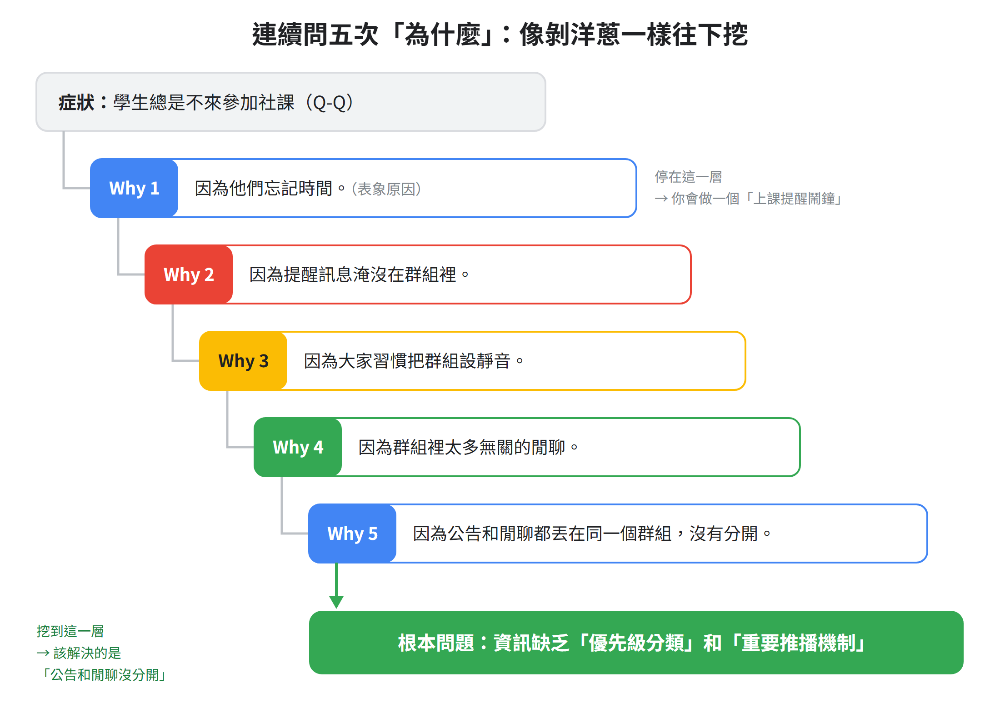

如果停在第一層，你可能會做一個「上課提醒鬧鐘」；挖到第五層，你會發現真正該解決的是「公告和閒聊沒分開」。

### 痛點的「頻率」與「強度」

不是所有的痛點都值得做成軟體專案，有些是真痛，有些實際上是假痛。好的專案問題通常是「很常發生」或「很痛」：

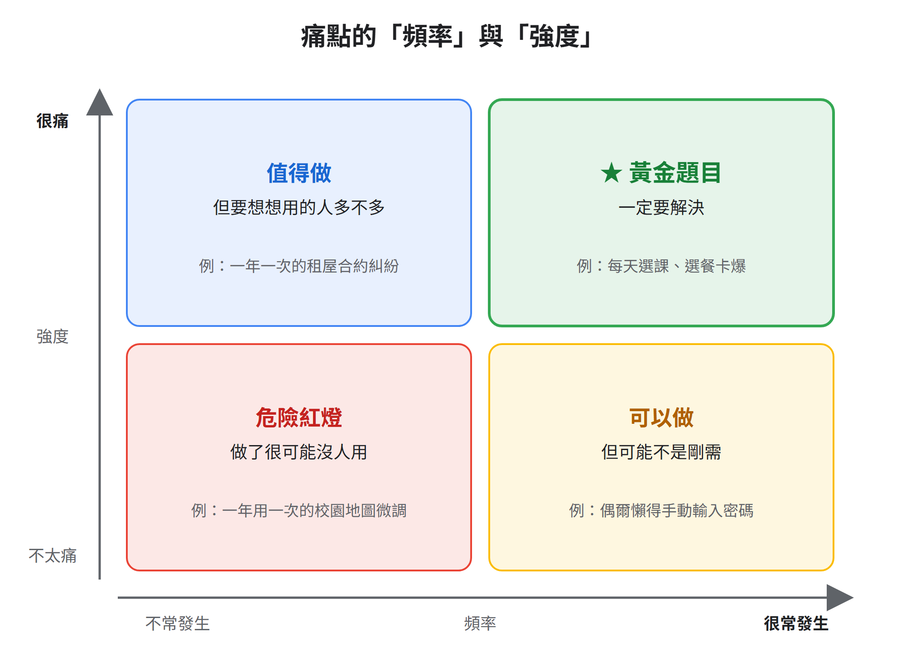

### 問題句型

最後，用一句公式把散亂的痛點組合起來，變成這個專案的「指南針」：

```text
「[哪一群特定使用者] 在 [什麼特定情境下]，遇到了 [什麼具體困難]，導致了 [什麼壞結果／浪費了什麼]。」
```

傳送門的版本：

```text
「住在板橋的北大學生，在趕早八的時候，通勤要將近一個小時，導致常常遲到、早上也睡不飽。」
```

### 討論：問題句健康檢查

寫下你的問題句（這是起步卡的第一欄），然後跟旁邊的人交換，幫對方檢查：

```text
□ 句子裡有沒有出現任何技術或工具的名字？（有的話塗掉，只留想解決的問題）
□ 這個問題是他自己想像的，還是真的有觀察過、問過兩三個人？
□ 解決之後，使用者能省下什麼（時間、錢），或得到什麼（方便、快樂）？
```

---

## 2. 把想法畫成一條路：4 步使用流程

在 AI 時代，快速做一個 Prototype 的成本大幅降低，「先做再說，再根據結果調整」已經是很實用的開發方式。

所以先講結論：**如果這是你的第一個作品，就用 Prototype-First——先做一個最陽春、能動的版本，再邊用邊改。** 這對新手來說是最好的選擇，不是偷懶。

但「先做」之前，至少花三分鐘把使用者會走的路寫下來，不然 AI 跟你都不知道要做什麼。四步就夠：

```text
1. 使用者：走到捷運站旁的傳送門，說「我欲去士林夜市」
   看到的：辨識台語，顯示「目的地：士林夜市，確認？」
                ↓
2. 使用者：說「著」或按確認
   看到的：系統檢查士林那邊的傳送門有沒有人卡著
                ↓
3. 使用者：拿著鹹酥雞走進門
   看到的：掃描人＋鹹酥雞，倒數 3 秒
                ↓
4. 使用者：走出門
   看到的：人在士林夜市，顯示「傳送完成，耗時 8 秒」
```

> 寫不出四步？通常代表你還不知道使用者要「完成什麼事」，回去看一下你的問題句。

### ✏️ 練習：我的 4 步使用流程

| 步驟 | 使用者做什麼？ | 系統做什麼／使用者看到什麼？ |
| --- | --- | --- |
| 1 |  |  |
| 2 |  |  |
| 3 |  |  |
| 4 |  |  |

### 進階：想法大到「做了再看」撐不住的時候

如果你已經有一些實作經驗、想做的東西比較大，或是要跟別人一起討論，可以試試下面這些我常用的思維模式。**不用全部都用，看你手上已經有什麼，挑一種當起點：**


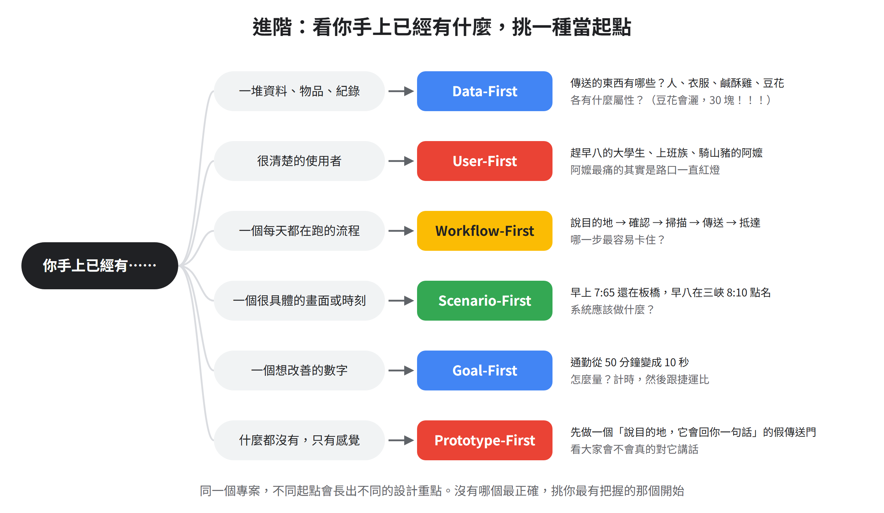


:::spoiler 課後看：把 4 步流程畫成粗粗的畫面草圖（Breadboard）

4 步流程寫好之後，如果你想知道「大概會有幾個畫面、幾顆按鈕」，可以畫一張 **Breadboard**。這是軟體公司 Basecamp 在《Shape Up》裡推的畫法，名字來自電子工程的麵包板：上面有零件和電線，但沒有外殼。

只用文字和箭頭，畫三種東西：

| 元素 | 是什麼 | 怎麼畫 |
| --- | --- | --- |
| **地點** | 使用者會去的畫面 | 文字加底線 |
| **可操作的東西** | 按鈕、輸入框、文字 | 寫在地點下面 |
| **連線** | 按了之後去哪裡 | 箭頭 |

傳送門的 Breadboard：

```text
傳送門畫面              確認                     傳送中               抵達
‾‾‾‾‾‾‾‾‾‾              ‾‾‾‾                     ‾‾‾‾‾‾               ‾‾‾‾
[ 說出目的地 ] ───→     目的地：士林夜市          掃描人＋鹹酥雞       傳送完成，耗時 8 秒
                        [ 著（確認）] ─────→      倒數 3、2、1 ───→   [ 再傳一次 ]
                        [ 重說 ] ──┐
      ↑                            │
      └────────────────────────────┘
```

就這樣，沒有顏色、沒有排版、沒有 icon，但你已經知道有四個畫面、幾顆按鈕，每顆按下去會去哪裡。

重點是**刻意畫粗**：畫太細，你會花一整晚在糾結按鈕要圓角還是直角，而且捨不得改；AI 也會照抄你的細節，就算那些細節不好。夠具體可以開工、夠模糊保留彈性，就剛剛好。

:::

---

## 3. 新手的三個問題：有沒有人要？做不做得出來？做不做得完？

上一節是把想法**展開**；這一節要把它**收回來**。

很多第一個作品不是死在技術，而是死在下面這三題的其中一題。我們的傳送門也逃不掉：


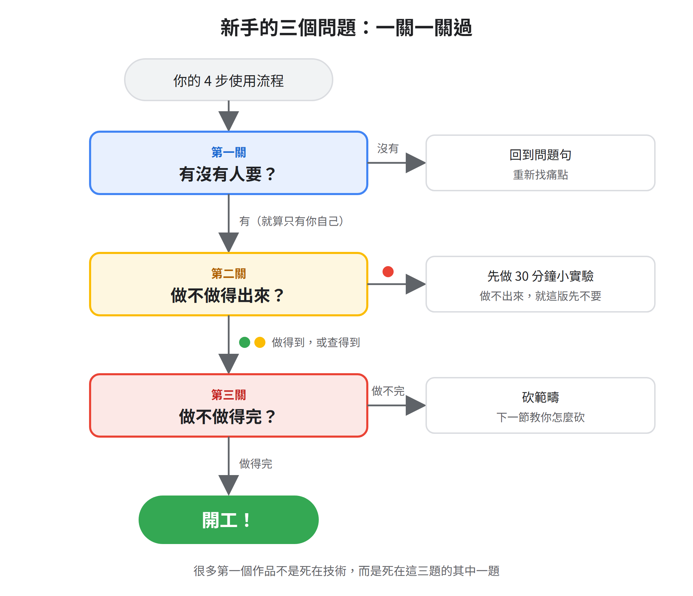

| 關卡 | 問自己什麼 | 傳送門的答案 | 卡住了怎麼辦 |
| --- | --- | --- | --- |
| **有沒有人要？** | 我（或我問的三個人）現在怎麼處理這件事？ | 我每天通勤 50 分鐘，捷運轉公車，還常常遲到 | 沒人要 → 回去改問題句 |
| **做不做得出來？** | 每個功能標燈號：🟢 我會做／🟡 查得到、AI 能帶我做／🔴 完全不知道 | 確認畫面 🟢、國語語音辨識 🟡、傳送人 🔴🔴🔴（物理系說要再等等） | 🔴 → 先花 30 分鐘做小實驗；做不出來就這版先不要 |
| **做不做得完？** | 每週可以投入幾小時？要做幾週？ | 每週 4 小時 × 3 週 ＝ 12 小時 | 做不完 → 砍範疇（下一節） |

每一關各提醒一件事：

- **有沒有人要**：做給自己用完全沒問題，第一個使用者就是你，但要誠實，我真的會每週用它嗎？做給別人用就去問，而且問的是**他現在怎麼處理**，不是「如果有傳送門你會用嗎」。後者每個人都會說會，然後你就得到一個完全沒用的答案。
- **做不做得出來**：🔴 不是不能做，而是要**最先處理**。拿 30 分鐘做一個只為了回答「這做得出來嗎」的小實驗，工程師叫它 **Spike**。例如找一個台語語音辨識的服務，錄五句「我欲去士林夜市」，看它聽對幾句。至於傳送人這種 30 分鐘驗證不完的 🔴，意思就是：**這一版先不要。**
- **做不做得完**：這題最常被跳過，也最常讓作品死掉。下一節我們用一個數字回答它。

> 能用問的就不要用做的，**寫程式是最貴的驗證方式。**

:::spoiler 課後看：不寫程式，也能知道有沒有人要

能用便宜的方法知道答案，就不要用貴的：


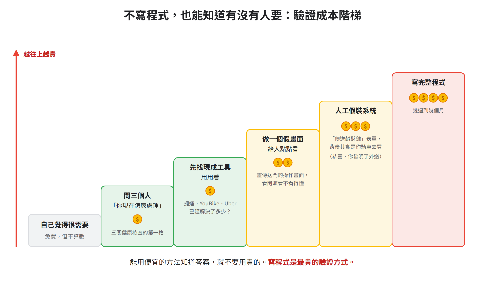

如果現成工具已經解決得很好，那也很好，你省下了一個月。如果它哪裡不好用，那個「不好用」就是你的專案亮點。

新創圈還有幾種「假裝產品已經存在」的經典做法，名字很好記：

| 方法 | 怎麼做 | 使用者知道是人工嗎？ | 傳送門版本 |
| --- | --- | --- | --- |
| 🙋 **人肉服務**（Concierge） | 你親自手動提供服務 | 知道 | 你親自幫同學查好路線，每天提醒他幾點出門 |
| 🧙 **綠野仙蹤**（Wizard of Oz） | 前台看起來像產品，後台其實是你在手動處理 | 不知道 | 上面那張「傳送鹹酥雞」表單 |
| 🚪 **預告頁**（Fake Door） | 做一個介紹頁，看多少人點「我要用」 | 點了才知道還沒上線 | 做一頁「傳送門即將開通」，看多少人留下聯絡方式 |
| 🎬 **影片 Demo** | 拍一支影片展示「如果有這個產品」 | 知道 | 拍一支 30 秒短片，假裝傳送成功 |

兩個很有名的例子：Zappos 剛開始在網路上賣鞋時，是先去實體店拍鞋子放上網站，有人下單才去店裡用原價買下來寄出去；Dropbox 則是先放一支幾分鐘的 demo 影片加上等待名單，看到大家真的想要，才放心投入開發。

那要先測哪一件事？挑「**錯了整個點子就會垮，而且你現在還沒有證據**」的那一件。

幾個小提醒：

- 預告頁要誠實，別人點了「我要用」之後，要清楚告訴他還在準備中，不要讓人覺得被騙。
- 點「通知我」只代表好奇，不代表會用。能讓對方多付出一點點（例如留下他每天幾點出門），訊號會準很多。
- 人數不用多。認真跟 5 個人聊一聊，比數到 100 個 email 有用。

:::

### ✏️ 練習：三關健康檢查（寫進起步卡）

```text
第一關：找旁邊的人當受訪者，問他「你上次遇到這個問題時，是怎麼處理的？」
        他的回答：＿＿＿＿＿＿＿＿＿＿
        跟我原本以為的一樣嗎？＿＿＿＿
第二關：我的 🔴 是＿＿＿＿；我的 30 分鐘小實驗是＿＿＿＿
第三關：👇 下一節一起算
```

---

## 4. MVP：把那條線畫出來

第三關「做不做得完」，要在這一節回答：先算出你有多少時間，再把線畫出來。

### 4-1. 你唯一能調的，只有範疇

還記得前言說的，專案就是三件事嗎？範疇、時間、資源。這三個會互相拉扯，業界把它畫成一個三角形，叫做「**專案鐵三角**」，剛好對上我們的三個問題：


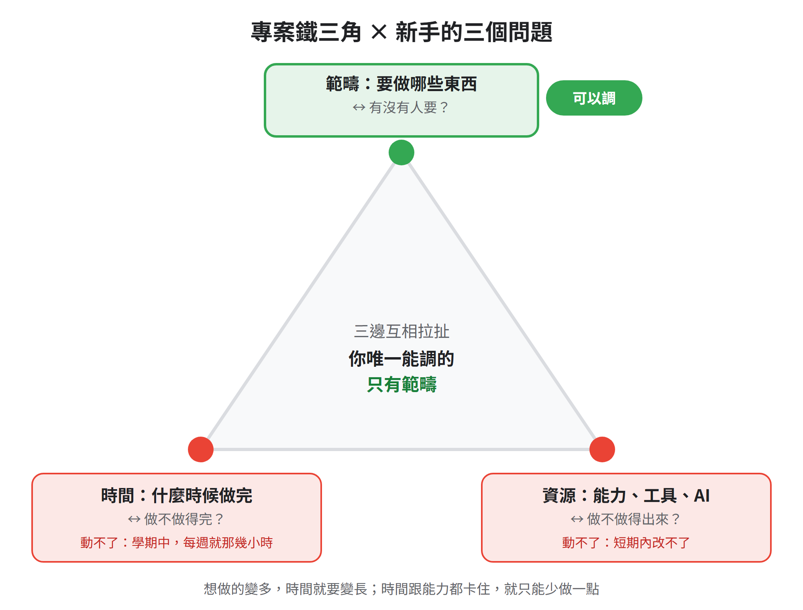

所以結論很殘酷也很簡單：

> **時間和能力都動不了，你唯一能調的只有範疇。**

範疇不只是「我要做什麼」，更重要的是「**我這次不做什麼**」。沒寫下來的範疇會偷偷變大：「欸傳送門順便可以傳豆花好了」「欸要不要加個傳送到日本的國際版」……這叫 **Scope Creep（範疇蔓延）**，是個人專案的頭號殺手。每多一個「順便」，截止日就默默往後跑一點。

### 4-2. 不用甘特圖，用時間預算

做第一個作品不需要甘特圖，你只需要算一個數字：

```text
每週可以投入的小時數 × 週數 ＝ 你的總時間預算

例如：每週 4 小時，打算 4 週做完
      → 留 1 週緩衝給期中考、報告、社團活動
      → 4 小時 × 3 週 ＝ 12 小時   ← 這就是你的時間預算
```

再記住兩個新手生存法則：

```text
法則 1：估時直接乘 2 到 3
   你覺得 2 小時能做完 → 加上裝環境、查錯誤、AI 寫錯重來 → 實際 4～6 小時
   這不是你特別慢，大家都這樣，工程師也是

法則 2：時間盒（Timebox）
   截止日先定死 → 做不完就砍範疇，不要延期
   延期一次，就會延期第二次
```

### 4-3. MVP 是算出來的

有了時間預算，就可以畫線了：把你想做的功能全部列出來，**從最重要的往下排**，估時乘 2 到 3 之後一路往下加，加到超過時間預算的那一刻，畫一條線。

傳送門的時間預算是 12 小時，開始排：

```text
順序  功能       估時    累計
 1    傳送人      ∞       ∞
```

……好，第一列就爆了。

這時候不是放棄，而是回到第 1 節：**痛點是「通勤太久、太麻煩」，傳送門只是我們想到的其中一種解答。** 傳送不了人，那在 12 小時內，什麼東西能讓通勤變輕鬆一點？

重新排一次：


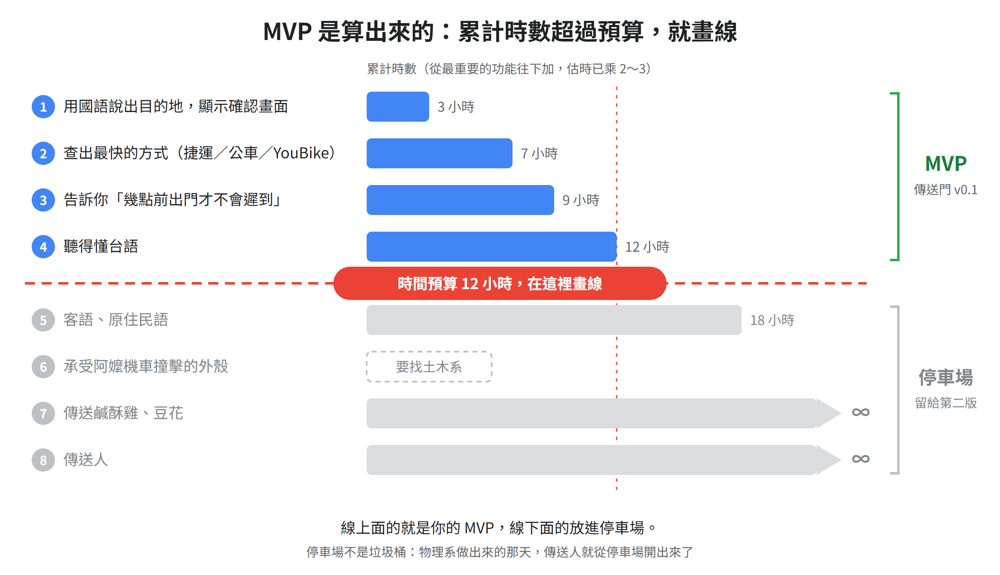

**線上面的就是你的 MVP，線下面的放進停車場。** 名字可以繼續叫「傳送門 v0.1」，沒人會阻止你。

> 停車場不是垃圾桶。被砍掉的點子不是刪掉，是留給第二版。做完 MVP 之後，你會比現在更知道停車場裡哪個最值得做。（物理系做出來的那天，傳送人就從停車場開出來了。）

### 4-4. MVP 不是簡陋版

MVP（Minimum Viable Product，最小可行產品）不是「什麼都做一點點的爛版本」，而是**用最少的功能，完成最核心的那件事**：

| 傳送門 | 第一版做 | 這次不做（停車場） |
| --- | --- | --- |
| 移動 | 告訴你最快怎麼到、幾點出門 | 真的把你傳過去 |
| 語言 | 國語＋台語 | 客語、原住民語（下一版優先） |
| 物品 | 不處理 | 鹹酥雞、豆花（豆花會灑） |
| 耐撞 | 它是手機上的網頁，不怕撞 | 阿嬤機車規格外殼 |

一個簡單的檢查方法：

> **「如果只剩一個週末，我仍然要完成＿＿＿＿。」**

傳送門的答案：說出目的地，就知道幾點出門、怎麼走最快。空格裡的那件事，就是你 MVP 的心臟，其他都可以等。

> 需求是「通勤更輕鬆」；傳送門只是其中一種解法。**不要把解法誤當成需求**，你的 MVP 才有機會活下來。

:::spoiler 課後看：線上面，還可以再分層

線上面的東西也有先後。哈佛大學的程式入門課 CS50，期末專題就要求學生替自己的作品訂**三層目標**：

| 層級 | 意思 | 傳送門 v0.1 |
| --- | --- | --- |
| **Good** | 不管發生什麼事，一定要做到的 | 說出目的地，顯示確認畫面和最快的路線 |
| **Better** | 正常情況下，覺得做得到的 | 告訴你「幾點前出門才不會遲到」 |
| **Best** | 一切順利的話，希望做到的 | 聽得懂台語 |
| **不做** | 停車場 | 客語、原住民語、耐撞外殼、傳送鹹酥雞和人 |

這張表厲害的地方是：**就算你只做到 Good，你也「完成」了一個作品**，而不是「做了一半的 Best」。

業界也很常用 **MoSCoW** 排優先順序，其實是同一件事換個名字：

| 類別 | 意思 | 對應 |
| --- | --- | --- |
| **M**ust have | 沒有就不能用 | Good |
| **S**hould have | 很重要，但沒有也能用 | Better |
| **C**ould have | 有的話很好 | Best |
| **W**on't have（this time） | 這次不做 | 停車場 |

新手最常犯的錯是什麼都標 Must。如果你的 Must 清單太長，就砍一半，真的。

:::

### 4-5. 小心「AI 幫我決定」

很多人到這一步會直接問 AI：「幫我規劃一個傳送門的 MVP」。AI 會很熱心、很認真地給你一份包含量子糾纏模組的完整清單，然後你就會得到一個做不完的 MVP。

```text
你決定：問題、優先順序、MVP 範圍
AI 協助：追問、比較、實作
```

AI 不知道你每週只有 4 小時，也不知道你最在意的是哪件事。這些只有你能決定。

### 🛠 實作：畫出我的線（寫進起步卡）

先算出你的時間預算：

```text
每週＿＿小時 × ＿＿週（已扣 1 週緩衝）＝ 時間預算＿＿小時；第一版截止日＿＿＿＿
```

再把你想做的功能全部列出來，從最重要的排到最不重要，估時乘 2～3，一路往下加，超過時間預算就畫線：

| 順序 | 功能 | 估時（已乘 2～3） | 累計 |
| --- | --- | --- | --- |
| 1 |  |  |  |
| 2 |  |  |  |
| 3 |  |  |  |
| 4 |  |  |  |
| ─ | **時間預算＿＿小時，畫線** | ─ | ─ |
| 5 |  |  |  |
| 6 |  |  |  |

```text
如果只剩一個週末，我仍然要完成：＿＿＿＿＿＿＿＿＿＿
第一版（線上面）：＿＿＿＿＿＿＿＿＿＿
停車場（線下面）：＿＿＿＿＿＿＿＿＿＿
```

---

## 5. 把 MVP 切成一步一步

MVP 有了，但「做一個傳送門 v0.1」還是太大，你打開電腦還是不知道第一步要幹嘛。所以要再切。

### 5-1. 橫著切 vs 直著切

上一課我們把**程式**拆成介面、規則、資料、回饋；這一課我們要拆的是**工作**。

把你的作品想像成一個三層蛋糕，新手最常見的切法是橫著切，一層一層吃：


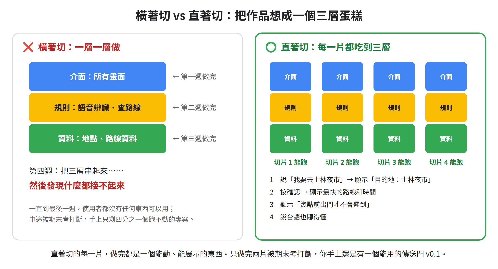

直著切的每一片，**做完就是一個能動、能展示的東西**。就算你只做完前兩片就被期末考打斷，你手上還是有一個能用的傳送門 v0.1，而不是四分之一個什麼都跑不動的專案。

> 不是「先做一個按鈕」或「先建資料庫」，而是讓使用者能完成一小件有意義的事。

### 5-2. 第一個切片，就是你的骨架

第 3 節提過 Spike。這裡順便把三個很容易搞混的東西一起分清楚，它們都是「先做一點點」，但目的完全不一樣：


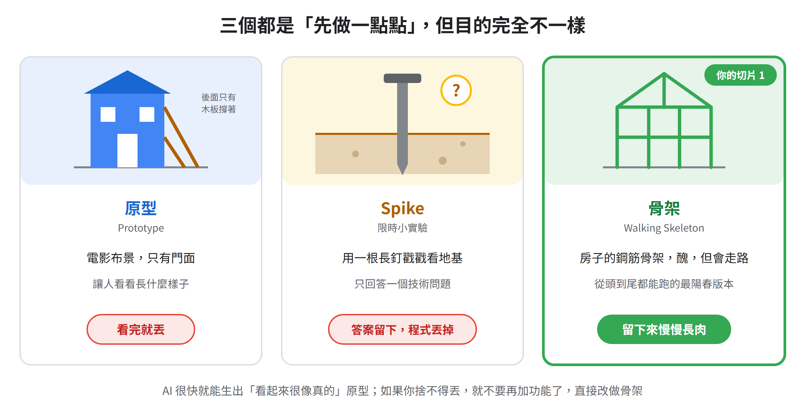

**你的切片 1，就應該是一副骨架**：很醜，但從第一步到最後一步都能跑。之後每一片，都是在幫它長肉。

用 AI 寫程式的時候這點特別重要：AI 很快就能生出一個「看起來很像真的」原型，然後你就捨不得丟，開始在上面一直加功能，加到最後變成一團屎山。

### 5-3. 一個切片，會穿過哪些地方？

拿切片 1 來看，一個切片會從上到下穿過第五課學過的四個責任區：

```text
切片 1：說「我要去士林夜市」→ 顯示確認

  介面 ── 一顆麥克風按鈕、一個確認畫面
   ↓
  規則 ── 把語音轉成文字，判斷這是不是一個存在的地點
   ↓
  資料 ── 一份地點清單（第一版先放 20 個常去的地方就好）
   ↓
  回饋 ── 成功：顯示「目的地：士林夜市，確認？」
          失敗：顯示「找不到這個地方，請再說一次」
```


這張圖畫得出來，你就知道這一片要叫 AI 改哪些地方；之後壞掉了，也知道該往哪一層找。

### 5-4. 怎麼知道一片做完了？

每一片都要寫上「怎麼知道做完了」，不然你會在同一片裡面一直改一直改。

```text
❌ 做好語音功能
✅ 用國語說「我要去士林夜市」，3 秒內畫面顯示「目的地：士林夜市，確認？」
```

| 驗收案例 | 預期結果 |
| --- | --- |
| 正常情況：說「我要去士林夜市」 | 顯示「目的地：士林夜市，確認？」 |
| 一個例外情況：說「我要去霍格華茲」 | 顯示「找不到這個地方，請再說一次」，不會當掉 |
| 不應被弄壞的既有行為 | 不想講話的人，用打字輸入目的地還是可以用 |

上一課的驗收表又回來了，因為它在寫程式之前就有用：**先想好怎麼驗收，AI 寫完你才知道要檢查什麼。**

:::spoiler 課後看：驗收寫得更嚴謹一點（Given／When／Then）

業界有一個很常見的寫法，來自「行為驅動開發（BDD）」，柏克萊大學的軟體工程課就用它把需求寫成可以檢查的情境：

```text
Given（在什麼情況下）
When （使用者做了什麼）
Then （系統應該怎麼反應）
```

傳送門切片 1 寫起來長這樣：

```text
情境 1：正常情況
Given 地點清單裡有「士林夜市」
When  我用國語說「我要去士林夜市」
Then  3 秒內畫面顯示「目的地：士林夜市，確認？」

情境 2：例外情況
Given 地點清單裡沒有「霍格華茲」
When  我說「我要去霍格華茲」
Then  畫面顯示「找不到這個地方，請再說一次」，而不是當掉

情境 3：不應被弄壞的既有行為
Given 我不想講話
When  我用打字輸入「士林夜市」
Then  一樣會顯示確認畫面
```

一個情境大概 3–5 句就好，太長代表你一次想測太多東西。

寫成這樣還有一個好處：可以直接請 AI 幫你變成自動測試。

```text
請根據下面的驗收情境，為每一條寫一個自動測試，測試名稱用情境名稱。
先列出你打算寫的測試清單給我確認，不要直接寫。
［貼上驗收情境］
```

之後每次 AI 改完程式，跑一次測試就知道有沒有把舊功能弄壞，這就是上一課講的「回歸測試」。

:::

### ✏️ 練習：我的切片清單（寫進起步卡）

把線上面的 MVP 切成幾片，**至少把第一片寫完整**：

| 切片 | 使用者能完成的一小件事 | 怎麼知道做完了 | 燈號 |
| --- | --- | --- | --- |
| 1 |  |  |  |
| 2 |  |  |  |
| 3 |  |  |  |

> 🔴 的那片，記得用第 3 節的 30 分鐘小實驗先戳一下。切片之間如果有先後關係，被最多片依賴的那一片，就是你最該先做的。

---

## 6. 專案起步卡：一份給人也給 AI 看的文件

到這裡，你手上已經有：問題句、4 步流程、三關檢查、時間預算、MVP 和停車場、切片清單。把它們放在同一個地方，就是你的**專案起步卡**：


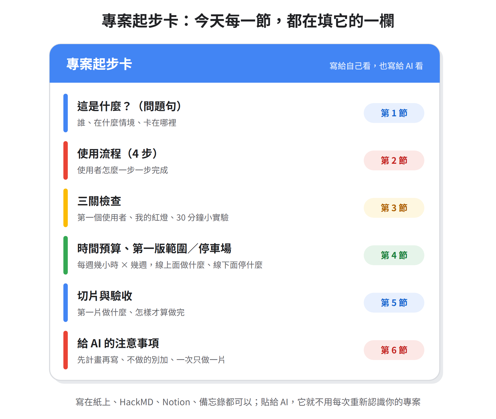

### 6-1. 為什麼要寫成一份？

這份文件其實有三個讀者：

| 讀者 | 他要從這份文件知道什麼 |
| --- | --- |
| 未來的你 | 我當初為什麼要做這個？做到哪了？下一步是什麼？ |
| AI | 這個專案是什麼、範圍在哪、哪些東西不要幫我加 |
| 別人（同學、面試官、評審） | 這個作品解決什麼問題？怎麼用？做得怎麼樣？ |

**第二個讀者很多人會忘記。** 每次開新對話叫 AI 幫忙，都要重新解釋一次專案嗎？不用，把起步卡貼給它就好。你也可以把它放進 ChatGPT 的 Projects、Gemini 的 Gems，或是 AI coding 工具的專案說明檔（例如 `CLAUDE.md`、`AGENTS.md`），讓 AI 每次都先讀過。

這樣它就不會在你做傳送門 v0.1 的時候，突然幫你加上量子糾纏模組。

### 6-2. 起步卡模板

直接複製，把今天的練習貼進去。寫在紙上、HackMD、Notion、備忘錄都可以：

```markdown
# 專案名稱

## 這是什麼？
一句話：［問題句］

## 30 秒 demo
打開後我能＿＿＿＿，然後看到＿＿＿＿。

## 使用流程
1.
2.
3.
4.

## 三關檢查
- 第一個使用者：＿＿＿＿；他現在怎麼處理：＿＿＿＿
- 我的 🔴：＿＿＿＿；30 分鐘小實驗：＿＿＿＿
- 時間預算：每週＿小時 × ＿週 ＝ ＿小時；第一版截止日：＿＿＿＿

## 第一版範圍
- 做：
- 這次不做（停車場）：

## 切片與進度
- [ ] 切片 1：＿＿＿＿（完成標準：＿＿＿＿）
- [ ] 切片 2：
- [ ] 切片 3：

## 給 AI 的注意事項
- 我是程式新手，請先解釋計畫再寫程式。
- 不要加入「這次不做」裡的功能。
- 每次只做一個切片。
```

:::spoiler 課後看：起步卡寫不出來？讓 AI 反過來訪問你

有些欄位你可能卡住，寫不太出來。這時候不要硬寫，請 AI 反過來訪問你，問到它能幫你整理出起步卡為止。這招在 Claude Code 的官方最佳實踐裡也有特別推薦。

```text
我想做：［一句話描述你的點子］。
請你扮演產品經理，先不要寫任何程式。
一次只問我一個問題，問到你能幫我整理出一張專案起步卡為止。
起步卡要包含：問題句、4 步使用流程、第一個使用者、最難的地方、時間預算、
第一版要做和不做的事、第一個切片和它的完成標準。
問完之後，照這個格式整理給我。
```

兩個小技巧：

- AI 問你的問題，如果你回答「都可以」，那就代表**你還沒決定**，請自己決定一個。
- AI 幫你整理好之後，**一定要自己讀一遍**，把不是你要的刪掉。起步卡是你的，不是 AI 的。

:::

### 6-3. 讓 AI 當規劃夥伴

起步卡寫好之後，先別急著叫 AI 寫程式。先讓它當你的規劃夥伴挑毛病：

```text
這是我的專案起步卡：［貼上］

請不要寫程式。請：
1. 問我最多 5 個最能縮小範圍的問題；
2. 檢查我是不是把需求、功能和解法混在一起；
3. 檢查我的切片是不是「直著切」，每一片做完都能跑；
4. 指出哪一片的完成標準太模糊；
5. 根據我的時間預算，告訴我最可能做不完的地方；
6. 針對我的 🔴，建議一個 30 分鐘內可以完成、用來確認「做不做得出來」的小實驗；
7. 標示你做出的假設。
```

確認沒問題之後，再開始第一個切片：

```text
這是我的專案起步卡：［貼上］
我現在要做切片 1：［內容］，完成標準是：［內容］。

請先提出計畫，不要直接寫完整專案：
1. 這個切片需要建立或修改哪些檔案，各自負責什麼（介面／規則／資料／回饋）；
2. 可以一步一步完成的小步驟；
3. 我要怎麼測試它符合完成標準。
```

檢查 AI 的答案：它有沒有偷加你說過不做的功能？它是不是一次想做完好幾個切片？哪一項是假設而不是事實？

### ✏️ 練習：把起步卡交給 AI

把你今天寫的起步卡貼給 AI，跑一次上面第一個 prompt。看看它問了你什麼問題，你答得出來嗎？

> 時間不夠的話，回家再跑也可以。

### 6-4. 回到開頭：專案沒有交作業的按鈕，那怎樣才算「做完」？

作業交出去就結束了，但作品要「別人真的能用」，還有幾件事要想。第一版不一定全部要有，但至少知道它們存在：

| 問題 | 第一版可以怎麼做 |
| --- | --- |
| 別人要怎麼用到它？（部署） | 網頁可以先放到免費的網頁託管服務；小工具可以附上安裝和執行說明 |
| 資料存在哪裡？ | 先存在本機或一個檔案就好，確定需要再上資料庫 |
| 有用到 API Key 嗎？（例如語音辨識、查路線） | 不要直接寫在程式碼裡，也不要放進要分享出去的檔案 |
| 免費額度用完會怎樣？ | 先查一下你用的服務每個月免費多少，超過會不會自動扣錢 |
| 壞掉了我怎麼知道？ | 至少留一個讓使用者回報問題的地方（表單、你的 IG） |
| 別人看得懂怎麼用嗎？ | 起步卡的「30 秒 demo」補上截圖和使用步驟 |

**作品要能被看見。** 一個好的作品介紹，通常會有一張截圖或 GIF、一個能點的 demo 連結、一段「我做這個學到什麼」。面試官和評審通常不會下載你的程式來跑，他們只會花三十秒看你的介紹。

---

## 收尾：讓專案真的開始

今天的終點不是做完一個 App，而是讓你的作品不再只停在腦中。

還記得前言那棵專案規劃樹嗎？我們今天走過的路，就是有 ★ 的那幾條：

```text
出發之前   一個「欸？」
   ↓
第 1 節    痛點 → 問題句                         ★ 痛點分析、問題定義
   ↓
第 2 節    4 步使用流程                          ★ 使用情境
   ↓
第 3 節    三關：有沒有人要？做不做得出來？做不做得完？ ★ 風險與限制
   ↓
第 4 節    時間預算畫線 → MVP＋停車場             ★ 開發管理規劃、目標與範疇、驗證與 MVP
   ↓
第 5 節    直著切 → 第一個切片＋驗收               ★ 功能需求、品質管理
   ↓
第 6 節    專案起步卡 → 交給 AI → 開工
```

### 回去後的第一週

1. 把起步卡寫完，貼進你常用的 AI 專案（或存在你找得到的地方）。
2. 做完你的 30 分鐘小實驗（如果有 🔴 的話）。
3. 開始切片 1，做完就在起步卡上打勾。

:::spoiler 課後看：真的開始做切片 1

切片 1 就是你的骨架。先選一條你走得動的路，**沒有哪條比較高級，能用最簡單的工具從頭跑到尾，就是好骨架**：

| 路線 | 用什麼做 | 適合誰 | 能不能很多人一起用 | 怎麼分享給別人 |
| --- | --- | --- | --- | --- |
| 🟢 A | Google 表單＋試算表 | 完全不想寫程式 | ✅ | 分享表單和試算表連結 |
| 🟢 B | 單頁網頁＋存在瀏覽器裡 | 只給自己用的小工具 | ❌（每個人只看得到自己的） | 免費的網頁託管服務 |
| 🟡 C | Python＋Streamlit | 會一點 Python、想做資料類的作品 | 看資料存在哪 | Streamlit 的免費雲端 |
| 🔵 D | 自己選技術＋雲端資料庫 | 技術比較強、想挑戰 | ✅ | 自己選 |

一個用表單加試算表做出來、明天就能用的東西，比一個做了一半的漂亮 App 有價值多了。

叫 AI 幫你打通骨架：

```text
這是我的專案起步卡：［貼上］
我選擇的做法是：［路線 A／B／C／D］。

請幫我做出切片 1 的「骨架」：
1. 每一步只用最簡單的做法，不要加任何切片 1 以外的功能；
2. 不用好看，能從頭走到尾就好；
3. 先告訴我會有哪些檔案，各負責介面／規則／資料／回饋的哪一部分；
4. 我確認之後再寫程式；
5. 最後告訴我怎麼在自己的電腦上執行。
```

做好之後，用這張表檢查：

| 檢查項目 | 通過？ |
| --- | --- |
| 我能從第一步走到最後一步，不卡住 |  |
| 切片 1 的完成標準都有做到（就算很醜） |  |
| 有碰到四個責任區：介面、規則、資料、回饋 |  |
| 關掉再打開，該留著的資料還在 |  |
| AI 沒有偷偷加切片 1 以外的功能 |  |

最後一條很重要。AI 很熱心，常常會「順便」幫你加功能，看到就刪掉。

:::

> **第一個作品，做完比做大重要。** 做完一個小東西，你會學到的比規劃一個大東西多十倍。台灣人今天還是不能飛，但至少某人不會遲到了。

### 跟社團小專案的關係

今天練的是**一個人**怎麼把想法變成作品。你在社團小專案裡會遇到另一半：**一群人**怎麼一起做，像是怎麼分工、怎麼讓別人檢查你的修改、怎麼不把彼此的程式改壞。那些會由各組的技術幹部帶著大家實際走一遍。

如果你今天還想不到自己的題目，也可以先用你所屬小專案的主題，把今天的練習走一遍，方法是一樣的。

**下回不知道有沒有反正待續 Whatever ... To Be Continued：**

> 今天我們學會了「從一個純文字想法，到一個可以開工的專案」；

> **接下來，就是真的動手把它做出來的時候了！**


